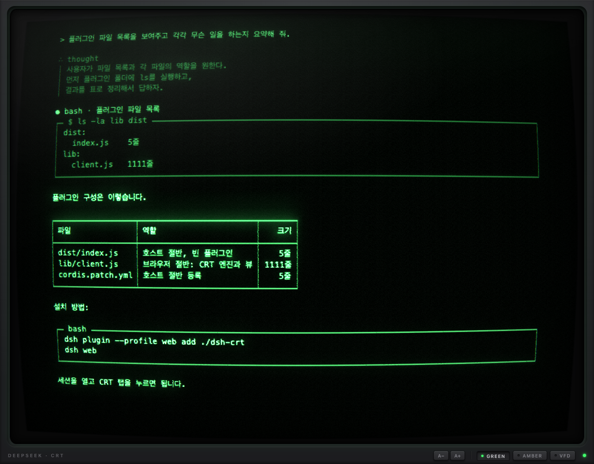
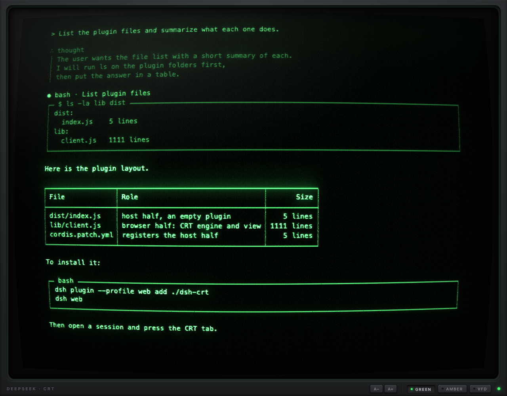
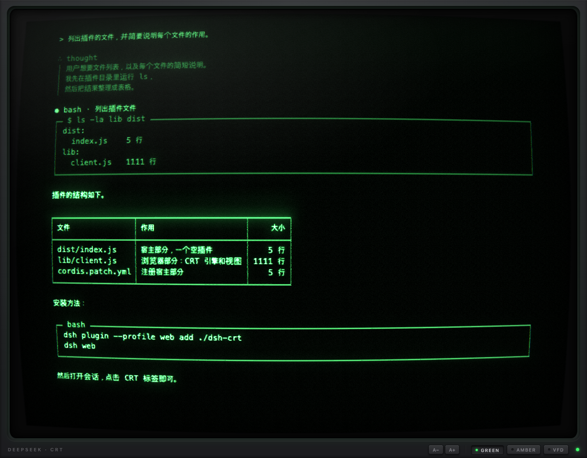
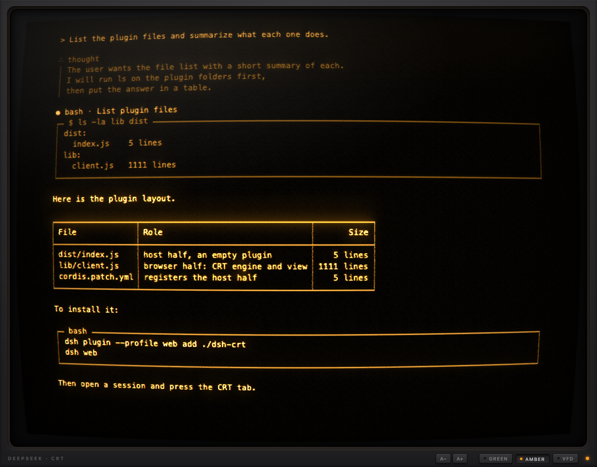
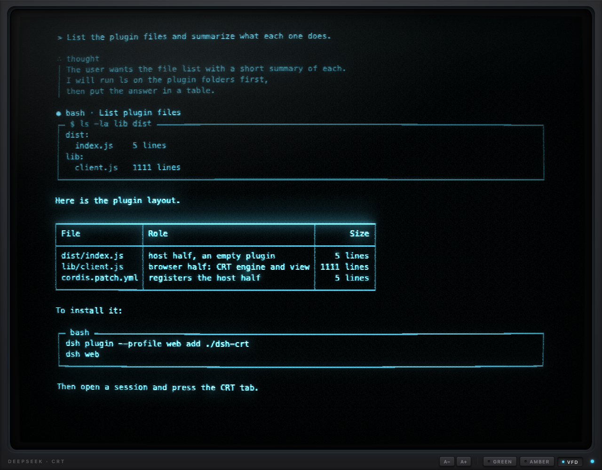

<div align="center">

# dsh-crt

**DeepSeek Harness 대화를, 빛나는 인광 CRT 모니터에서.**

*실용성은 하나도 없는 순수 레트로 플러그인. 모든 픽셀이 진짜 WebGL 셰이더 파이프라인을 통과합니다.*

[English](README.md) · **한국어** · [中文](README.zh.md)



</div>

## 이게 뭔가요?

`dsh-crt`는 [DeepSeek Harness](https://github.com/deepseek-ai/deepseek-harness)(`dsh`) 웹 UI용 플러그인입니다. *Chat*, *Trajectory* 옆에 **CRT** 탭을 하나 더 만들고, 실시간 대화를 옛날 모니터 화면에 그려 줍니다. 휘어진 유리, 주사선, 번지는 인광, 전원 LED가 달린 플라스틱 베젤까지 갖췄습니다.

쓸모는 없습니다. 기본 Chat 뷰보다 빠르지도, 읽기 편하지도 않습니다. 토큰이 인광 화면 위로 흘러내리는 모습이 보기 좋아서, 그리고 **CRT를 CSS 필터로 흉내 내지 않고 원리 그대로 셰이더로 구현**해 보고 싶어서 만들었습니다.

## 화면 모습

### 세 가지 언어, 하나의 브라운관

비트맵 폰트 [Galmuri](https://github.com/quiple/galmuri)가 영문, 한글, 한자를 모두 지원해서 어떤 언어든 같은 도트 느낌으로 나옵니다.

| English | 한국어 | 中文 |
|:--:|:--:|:--:|
|  |  |  |

### 세 가지 인광

모니터 아래 턱의 버튼으로 바꿉니다. 선택은 브라우저에 저장됩니다.

| GREEN | AMBER | VFD |
|:--:|:--:|:--:|
|  |  |  |
| 기본값. 휘어진 유리와 느린 잔상. | 따뜻한 주황색, 조금 짧은 잔상. | 형광표시관: 평평한 유리, 촘촘한 메시, 아주 짧은 잔상. |

### 화면을 이루는 것들

- **인광 잔상**: 새 글자는 밝게 켜졌다가 천천히 사라져서, 스트리밍 중에는 커서 뒤로 희미한 꼬리가 남습니다.
- **주사선과 빔**: 글자 줄이 납작한 픽셀이 아니라 가우시안 빔이라서 선이 숨 쉬듯 보입니다.
- **Bloom**: 밝은 획의 빛이 주변 어둠으로 번집니다.
- **화면 휘어짐**: 유리가 볼록해서 직선이 모서리 쪽으로 휘고, 가장자리에 베젤이 살짝 보입니다.
- **RGB 마스크, 노이즈, 비네트**: 옅은 색 번짐, 약간의 grain, 어두운 모서리.
- **모니터 케이스**: 어두운 플라스틱, 안으로 꺼진 화면, 유리 반사, 각인 로고, 테마 색을 따라가는 전원 LED.

## 대화는 이렇게 보입니다

CRT 뷰는 Chat 뷰의 흐름을 터미널처럼 펼칩니다.

- **생각**: `∴ thinking…` 아래에 왼쪽 세로줄이 있는 흐린 글씨. 생각하는 동안 최신 줄을 따라갑니다.
- **명령 실행**: `● bash · 설명` 줄 아래에, `$ 명령`을 제목으로 단 상자 안에 실행 결과.
- **코드 블록**: 언어 이름을 제목으로 단 테두리 상자. 스트리밍 중에도 상자가 아래로 자랍니다.
- **표**: 마크다운 표를 격자 테두리로 그리고, 열 정렬을 따릅니다.
- **사용자 입력, AI 응답, 에러, 재시도**는 각각 다른 밝기로 표시됩니다.

생각 중에는 스피너, 응답 중에는 깜빡이는 커서가 표시됩니다. 상태줄 없이 화면 전체를 대화에 씁니다.


## 설치

요구 사항: dsh `0.2.2-rc.1` 이상, Node.js 24.9 이상.

`dsh-crt`의 **부모 폴더에서** 실행합니다. `add`의 상대 경로는 명령을 실행한 위치 기준입니다.

```bash
git clone https://github.com/doongchoong/dsh-crt.git
dsh plugin --profile web add ./dsh-crt
dsh web
```

세션을 열고 대화 위쪽 탭에서 **CRT**를 누르면 됩니다.

플러그인 파일을 고친 뒤에는 브라우저 새로고침으로 반영되고, `package.json`의 `dsh` 매니페스트를 바꿨다면 `dsh web`을 재시작합니다.

## 조작

| 조작 | 동작 |
|---|---|
| **A− / A+** (아래 턱) | 글자 크기 5단계. 누르면 옛날 모니터 메뉴처럼 `SIZE ███░░` 막대가 잠깐 뜹니다. 저장됩니다. |
| **GREEN / AMBER / VFD** (아래 턱) | 인광 색 전환. 저장됩니다. |
| 마우스 휠, 터치 | 지난 대화 스크롤 |
| ↑ ↓, Page Up/Down, Home/End | 키보드 스크롤 (먼저 화면을 클릭) |

## 참고

- WebGL2가 필요합니다. 없으면 색만 입힌 2D 캔버스로 대체하고, `prefers-reduced-motion`이면 잔상과 깜빡임을 줄입니다.
- Galmuri 폰트는 jsDelivr CDN에서 불러옵니다. 실패하면 시스템 고정폭 폰트를 씁니다.
- `ChatSnapshot.legacy`는 dsh가 호환용으로 남겨 둔 데이터라 이후 버전에서 바뀔 수 있습니다. 변환은 `toTerminal` 함수 하나에 모여 있어 그 부분만 고치면 됩니다.
- 위 스크린샷은 실제 `lib/client.js`와 셰이더를 헤드리스 Chrome에서 샘플 대화로 렌더링한 것입니다.

## 구조

```
dsh-crt/
├── package.json       dsh.bundle(호스트) + dsh.client(브라우저) 매니페스트
├── cordis.patch.yml   호스트 절반을 프로필에 등록
├── dist/index.js      호스트 절반(빈 플러그인)
├── lib/client.js      브라우저 절반: CRT 엔진, 대화 변환, CRT 뷰 (빌드 없음)
└── docs/screenshots/  README용 이미지
```

## 출처

엔진은 저자 블로그 글 [CRT터미널](https://doongchoong.github.io/posts/crt터미널/)에서 옮겼습니다.

## 라이선스

MIT
