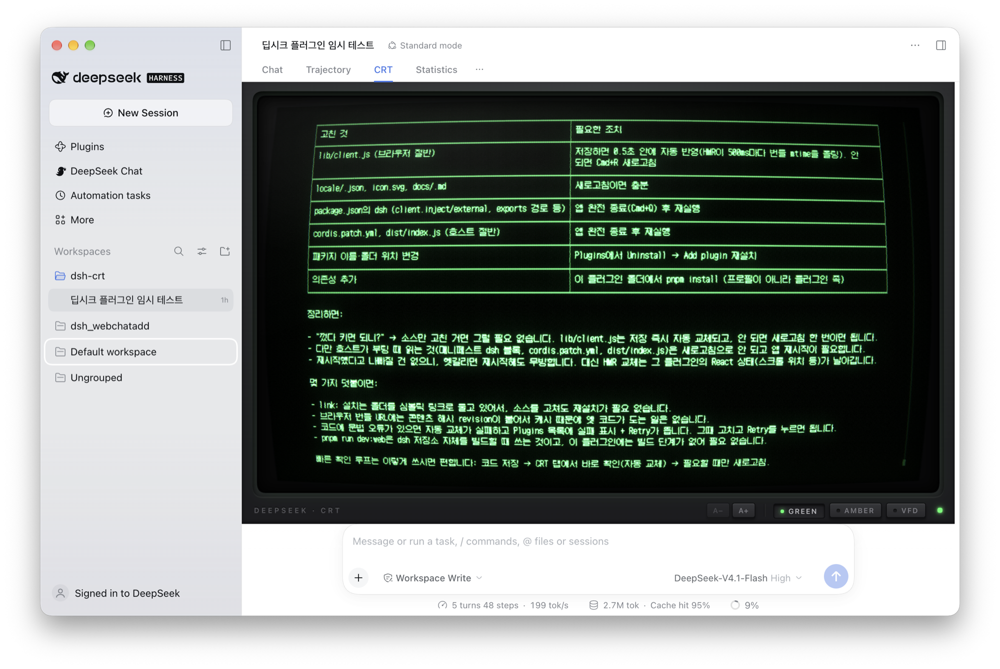
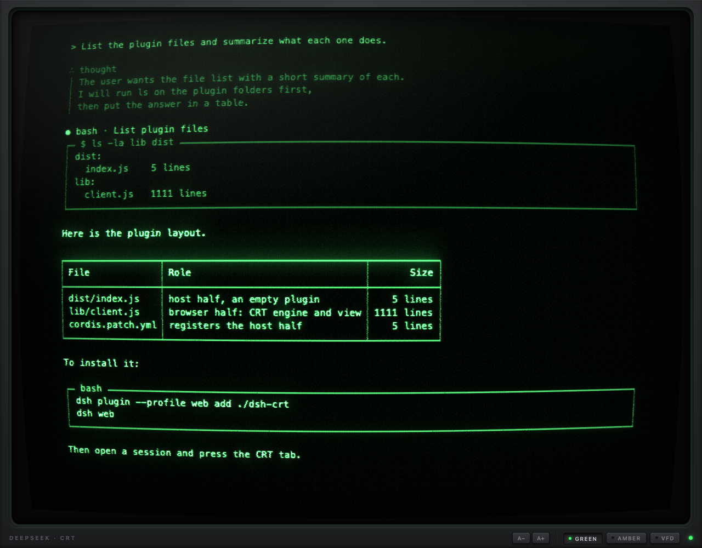
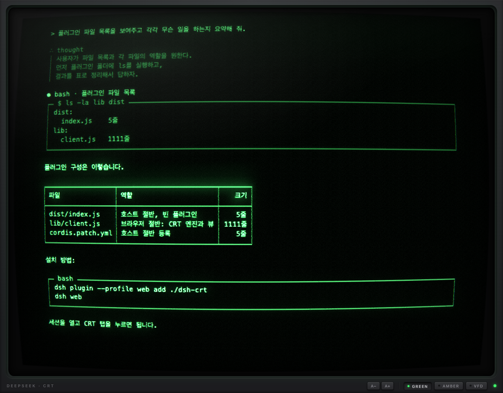
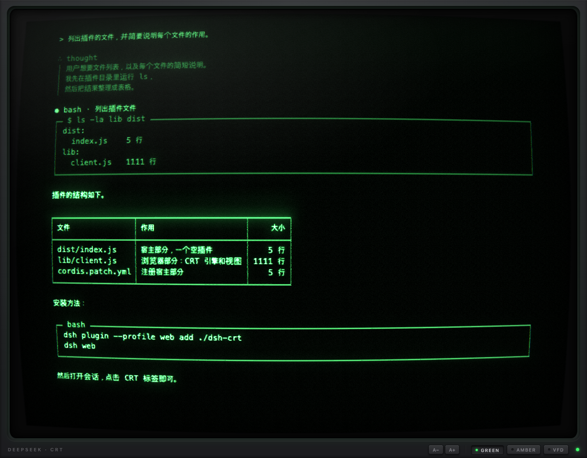
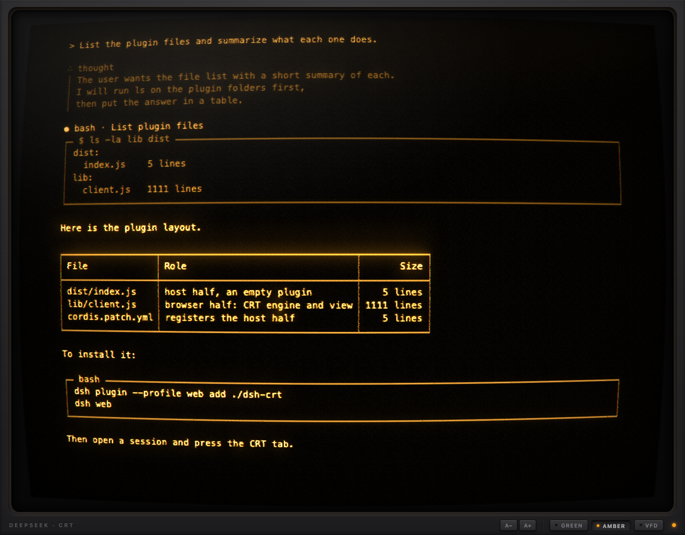
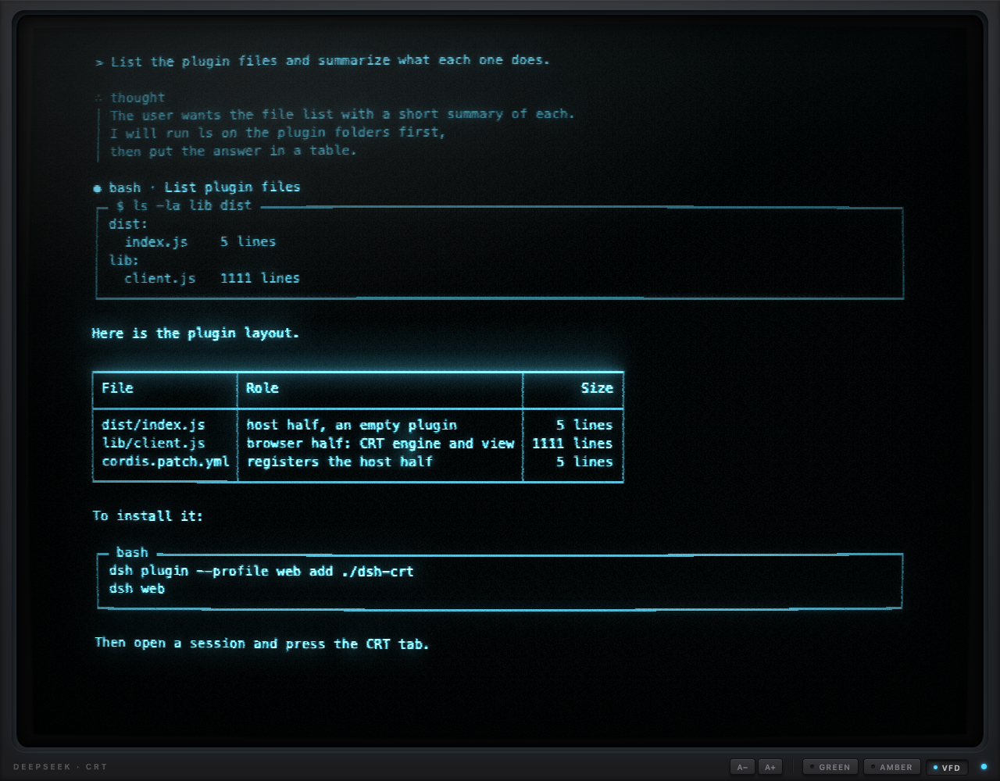

<div align="center">

# dsh-crt

**Your DeepSeek Harness conversation, on a glowing phosphor CRT.**

*A completely impractical, entirely retro plugin: every pixel goes through a real WebGL shader pipeline.*

**English** · [한국어](README.ko.md) · [中文](README.zh.md)



</div>

## What is this?

`dsh-crt` is a plugin for the [DeepSeek Harness](https://github.com/deepseek-ai/deepseek-harness) (`dsh`) web UI. It adds a **CRT** tab next to *Chat* and *Trajectory*, and draws the live conversation on a vintage monitor: curved glass, scanlines, glowing phosphor, a plastic bezel with a power LED.

It is not useful. It is not faster, not more readable, not better than the normal Chat view. It exists because watching tokens stream onto a phosphor screen is fun, and because the goal was to **simulate a CRT the way a CRT actually works**, in a shader, instead of faking it with a CSS filter.

## The look

### Three languages, one tube

The bitmap font ([Galmuri](https://github.com/quiple/galmuri)) covers Latin, Hangul and Chinese characters, so every language gets the same chunky pixel look.

| English | 한국어 | 中文 |
|:--:|:--:|:--:|
|  |  |  |

### Three phosphors

Switch with the buttons on the monitor's chin. The choice is remembered by the browser.

| GREEN | AMBER | VFD |
|:--:|:--:|:--:|
|  |  |  |
| The classic. Curved glass, slow afterglow. | Warm orange, a touch shorter afterglow. | A vacuum fluorescent display: flat glass, fine mesh, very short afterglow. |

### What the screen is made of

- **Phosphor persistence.** New text lights up bright and fades slowly, so streaming output leaves a faint trail behind the cursor.
- **Scanlines and beam.** Each text row is a Gaussian beam, not a flat pixel, so the lines breathe.
- **Bloom.** Bright strokes bleed light into the dark around them.
- **Barrel distortion.** The glass bulges; straight lines curve toward the corners, and a sliver of bezel shows at the edge.
- **RGB mask, noise, vignette.** Faint colour fringing, a little grain, darker corners.
- **A monitor around it.** Dark moulded plastic, a recessed tube, glass reflection, an engraved badge, and a power LED that matches the theme colour.

## What the conversation looks like

The CRT view lays the conversation out like a terminal, following the Chat view:

- **Thinking** appears as `∴ thinking…` with a dim, left-barred block that follows the latest lines.
- **Commands** show a `● bash · description` header, then the output in a titled box with the `$ command` as its label.
- **Code blocks** are boxes titled with the language.
- **Tables** are drawn with real grid lines and respect column alignment.
- **Your input**, **AI replies**, **errors** and **retries** each get their own brightness.

A spinner shows while the model is thinking, and a blinking cursor while it answers. There are no status bars: the whole screen is the conversation.


## Install

Requirements: dsh `0.2.2-rc.1` or newer, Node.js 24.9 or newer.

### Easiest: paste the GitHub address

In dsh web, open the plugin install dialog (**Add plugin**) and paste this address, then press **Install**:

```text
https://github.com/doongchoong/dsh-crt
```

No git commands needed. Then open a session and press the **CRT** tab.

### From the command line

Run this in the folder where you want the plugin cloned. The path given to `add` is relative to where you run the command.

```bash
git clone https://github.com/doongchoong/dsh-crt.git
dsh plugin --profile web add ./dsh-crt
dsh web
```

Open a session and press the **CRT** tab above the conversation.

After editing plugin files, a browser refresh is enough. If you change the `dsh` manifest in `package.json`, restart `dsh web`.

## Controls

| Control | Action |
|---|---|
| **A− / A+** (chin) | Text size, 5 steps. A `SIZE ███░░` bar pops up on screen like an old monitor menu. Remembered. |
| **GREEN / AMBER / VFD** (chin) | Switch phosphor. Remembered. |
| Mouse wheel, touch | Scroll back through the conversation. |
| ↑ ↓, Page Up/Down, Home/End | Scroll with the keyboard (click the screen first). |

## Notes

- Needs WebGL2. Without it, the plugin falls back to a plain tinted 2D canvas. With `prefers-reduced-motion`, afterglow and flicker are toned down.
- The Galmuri font is loaded from the jsDelivr CDN. If it fails to load, a system monospace font is used.
- The plugin reads `ChatSnapshot.legacy`, which dsh keeps for compatibility and may change in later versions. The conversion lives in one function, `toTerminal`, so only that needs updating.
- The screenshots above were rendered by the real `lib/client.js` and shader pipeline in headless Chrome, fed with a sample conversation.

## Layout

```
dsh-crt/
├── package.json       dsh.bundle (host) + dsh.client (browser) manifest
├── cordis.patch.yml   registers the host half in the profile
├── dist/index.js      host half (an empty plugin)
├── lib/client.js      browser half: CRT engine, conversation conversion, CRT view (no build step)
└── docs/screenshots/  images used in this README
```

## Credits

Engine ported from the author's blog post, [CRT터미널](https://doongchoong.github.io/posts/crt터미널/).

## License

MIT
