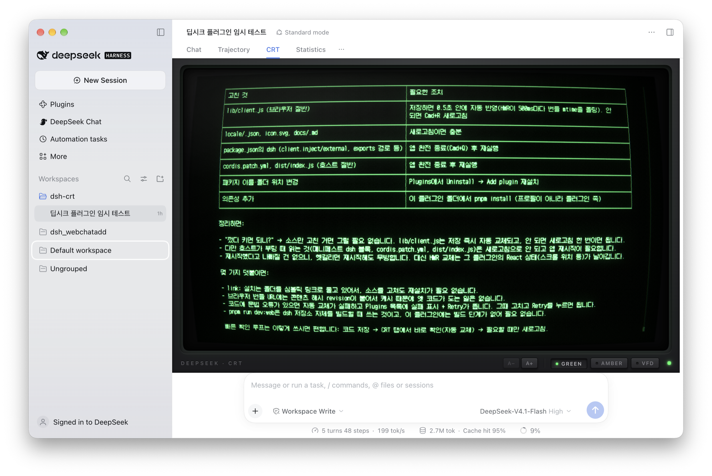
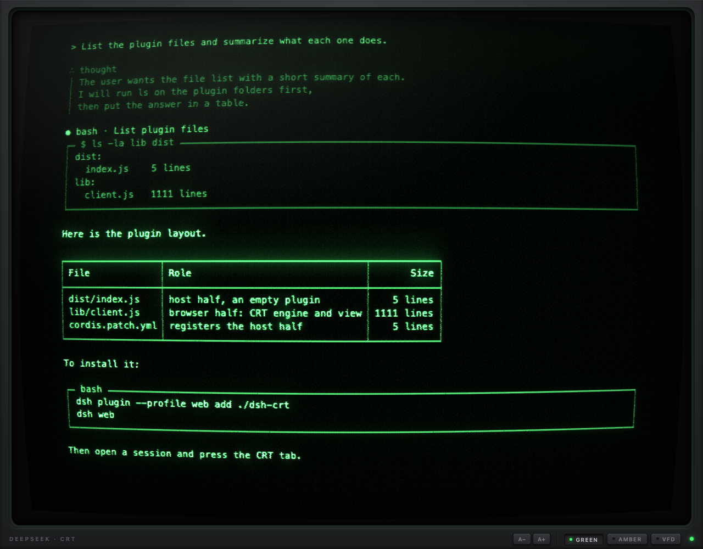
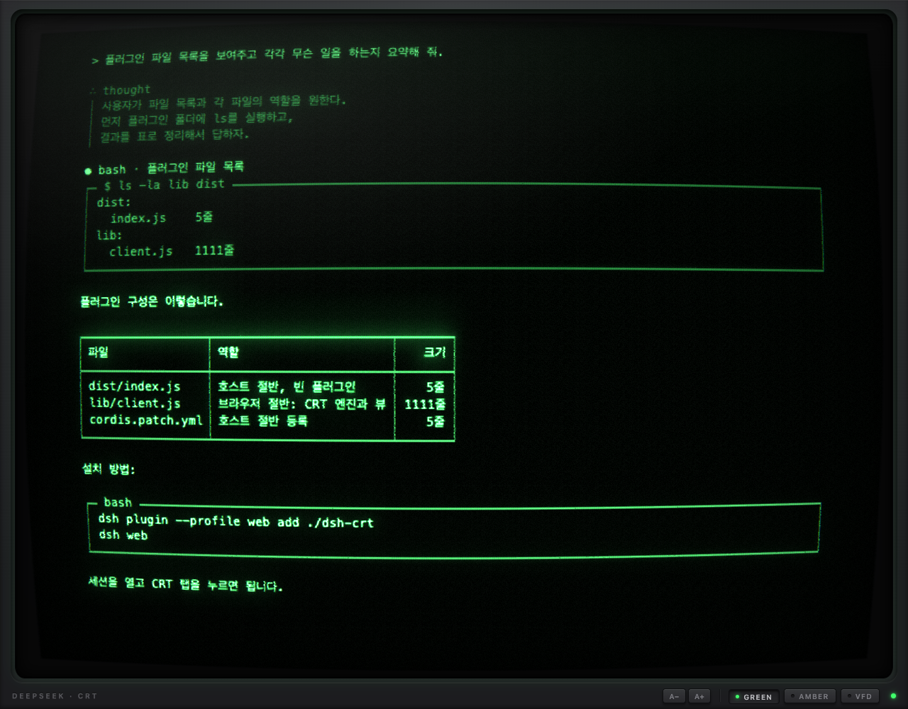
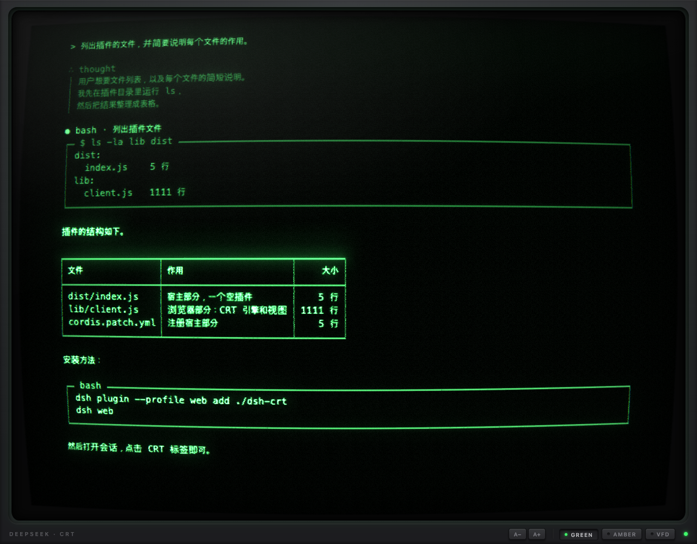
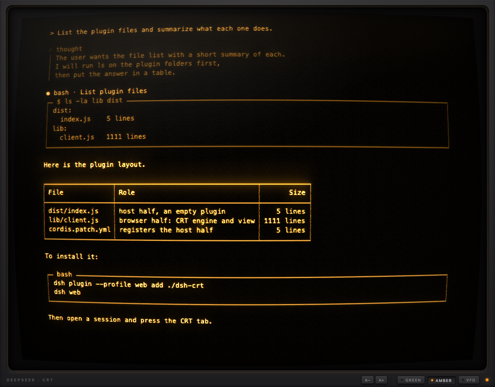
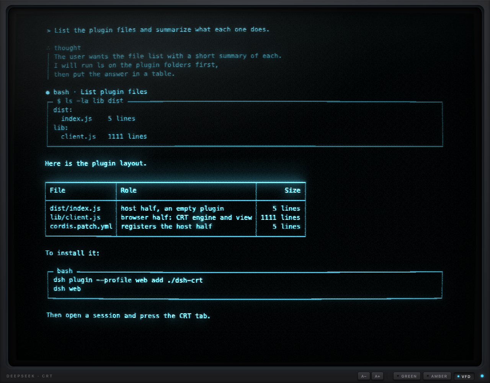

<div align="center">

# dsh-crt

**让你的 DeepSeek Harness 对话，显示在发光的荧光粉 CRT 显示器上。**

*毫无实用价值的纯复古插件：每一个像素都经过真正的 WebGL 着色器管线。*

[English](README.md) · [한국어](README.ko.md) · **中文**



</div>

## 这是什么？

`dsh-crt` 是 [DeepSeek Harness](https://github.com/deepseek-ai/deepseek-harness)（`dsh`）网页界面的插件。它会在 *Chat* 和 *Trajectory* 旁边新增一个 **CRT** 标签页，把实时对话绘制在一台老式显示器上：弯曲的玻璃屏幕、扫描线、发光的荧光粉，以及带电源指示灯的塑料外壳。

它没有任何用处：不比普通的 Chat 视图更快，也不更易读。做它只是因为看着 token 流淌在荧光屏上很有趣，也因为目标是**按 CRT 真实的工作原理，用着色器来实现它**，而不是用一个 CSS 滤镜糊弄过去。

## 观感

### 三种语言，同一支显像管

点阵字体 [Galmuri](https://github.com/quiple/galmuri) 包含拉丁字母、谚文、假名和约 6500 个汉字，因此英文和韩文能完整呈现像素风格。字体中没有的汉字（例如部分简体字：显、对、话）会退回到系统字体显示。

| English | 한국어 | 中文 |
|:--:|:--:|:--:|
|  |  |  |

### 三种荧光色

用显示器下巴上的按钮切换，选择会保存在浏览器中。

| GREEN | AMBER | VFD |
|:--:|:--:|:--:|
|  |  |  |
| 默认。弯曲的玻璃，较长的余辉。 | 温暖的橙色，余辉略短。 | 真空荧光显示管：平面玻璃、细密网格、极短的余辉。 |

### 屏幕由什么构成

- **荧光粉余辉**：新文字亮起后缓缓褪去，流式输出时光标后面会拖着一条淡淡的尾迹。
- **扫描线与电子束**：每行文字是高斯光束而不是平坦的像素，线条仿佛在呼吸。
- **Bloom 泛光**：明亮的笔画把光晕溢到周围的暗处。
- **桶形畸变**：玻璃向外凸起，直线向角落弯曲，边缘露出一点外框。
- **RGB 荫罩、噪点、暗角**：淡淡的色彩边缘、少许颗粒、四角变暗。
- **显示器外壳**：深色模压塑料、内凹的屏幕、玻璃反光、刻印标志，以及跟随主题颜色的电源灯。

## 对话是什么样子

CRT 视图沿用 Chat 视图的内容，像终端一样排布：

- **思考**：显示为 `∴ thinking…`，下面是左侧带竖线的暗色文字，会跟随最新的几行。
- **命令执行**：`● bash · 说明` 一行，下面是以 `$ 命令` 为标题的方框，里面是执行结果。
- **代码块**：以语言名为标题的边框方框，流式输出时方框会向下增长。
- **表格**：用真正的网格线绘制，并遵循列对齐。
- **用户输入、AI 回复、错误、重试**各有不同的亮度。

思考时显示转圈动画，回答时显示闪烁的光标。没有状态栏，整个屏幕都用来显示对话。


## 安装

要求：dsh `0.2.2-rc.1` 或更高版本，Node.js 24.9 或更高版本。

### 最简单：粘贴 GitHub 地址

在 dsh 网页的插件安装窗口（**Add plugin**）中粘贴下面的地址，然后点击 **Install** 即可：

```text
https://github.com/doongchoong/dsh-crt
```

不需要任何 git 命令。之后打开会话，点击 **CRT** 标签。

### 命令行安装

在想要存放插件的目录中运行。`add` 的相对路径以运行命令的位置为准。

```bash
git clone https://github.com/doongchoong/dsh-crt.git
dsh plugin --profile web add ./dsh-crt
dsh web
```

打开一个会话，点击对话上方的 **CRT** 标签即可。

修改插件文件后，刷新浏览器即可生效；如果修改了 `package.json` 中的 `dsh` 清单，需要重启 `dsh web`。

## 操作

| 操作 | 作用 |
|---|---|
| **A− / A+**（下巴） | 字号共 5 档。按下时屏幕上会像老显示器菜单一样短暂出现 `SIZE ███░░` 条。会保存。 |
| **GREEN / AMBER / VFD**（下巴） | 切换荧光色。会保存。 |
| 鼠标滚轮、触摸 | 回滚查看历史对话 |
| ↑ ↓、Page Up/Down、Home/End | 键盘滚动（先点击屏幕） |

## 说明

- 需要 WebGL2。没有时会退回到仅着色的 2D 画布；开启 `prefers-reduced-motion` 时会减弱余辉和闪烁。
- Galmuri 字体从 jsDelivr CDN 加载，加载失败则使用系统等宽字体。
- 插件读取的 `ChatSnapshot.legacy` 是 dsh 为兼容而保留的数据，后续版本可能变化。转换逻辑集中在 `toTerminal` 一个函数里，只需修改这一处。
- 上面的截图由真实的 `lib/client.js` 和着色器在无头 Chrome 中用示例对话渲染而成。

## 结构

```
dsh-crt/
├── package.json       dsh.bundle（宿主）+ dsh.client（浏览器）清单
├── cordis.patch.yml   在配置文件中注册宿主部分
├── dist/index.js      宿主部分（空插件）
├── lib/client.js      浏览器部分：CRT 引擎、对话转换、CRT 视图（无需构建）
└── docs/screenshots/  README 使用的图片
```

## 来源

引擎移植自作者的博客文章 [CRT터미널](https://doongchoong.github.io/posts/crt터미널/)。

## 许可证

MIT
